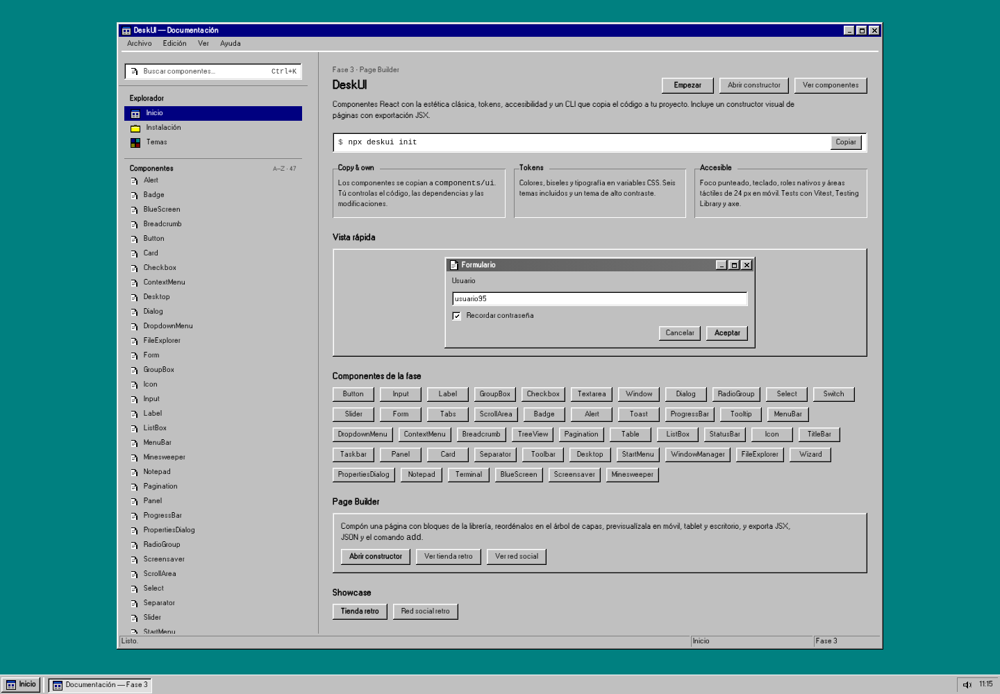

# DeskUI

**Componentes React con estética de escritorio clásico.** Tokens, accesibilidad,
TypeScript estricto y distribución *copy & own*: el CLI copia el código a tu
proyecto y desde ese momento es tuyo.

[](https://www.npmjs.com/package/deskui)
[](https://github.com/dev-plague/desk-ui/blob/master/LICENSE)
[](https://deskui.codehive.com.co)
[](https://github.com/dev-plague/desk-ui)

- **Documentación:** <https://deskui.codehive.com.co>
- **Catálogo de componentes:** <https://deskui.codehive.com.co/#/componentes>
- **Page Builder:** <https://deskui.codehive.com.co/#/constructor>
- **npm:** <https://www.npmjs.com/package/deskui>
- **Registry:** <https://deskui.codehive.com.co/r>



## Por qué DeskUI

- **Copy & own:** los componentes viven en tu repositorio en
  `components/ui/`, no en una librería opaca.
- **47 componentes** con API tipada, `forwardRef`, `className` y `data-slot`.
- **6 temas** con tokens CSS: `classic`, `gradient`, `high-contrast`, `desert`,
  `rose` y `storm`.
- **Accesible por defecto:** teclado, foco punteado, roles nativos, contraste AA
  y áreas táctiles de 24 px en móvil.
- **Bilingüe:** documentación y textos internos de los componentes en español e
  inglés.
- **Page Builder:** compón una página con 20 bloques, seis plantillas, preview
  responsive y exportación JSX/JSON.
- **CLI con registry offline:** `init`, `add` y `list` funcionan sin conexión.
- **Sin assets propietarios:** fuente W95FA (OFL) e iconos pixel art originales.

## Inicio rápido

```bash
npx deskui init
npx deskui add button input label group-box checkbox textarea
npx deskui add window dialog title-bar status-bar utils
npx deskui list
```

Requisitos: **Node.js 20.19+**, **React 18+** y **Tailwind CSS 4**.

`init` detecta `src/`, el alias de imports y el CSS de entrada; copia los tokens,
las fuentes y `lib/utils.ts`, y escribe `components.json`. `add` resuelve las
dependencias del registry y copia los componentes.

## Uso

```tsx
import { Button } from "@/components/ui/button";
import { Checkbox } from "@/components/ui/checkbox";
import { Input } from "@/components/ui/input";
import { Label } from "@/components/ui/label";
import { Window } from "@/components/ui/window";

export function Login() {
  return (
    <Window aria-label="Iniciar sesión">
      <Window.TitleBar title="Iniciar sesión" />
      <Window.Body>
        <Label htmlFor="user">Usuario</Label>
        <Input id="user" placeholder="usuario95" />
        <Checkbox>Recordar contraseña</Checkbox>
        <Button variant="primary">Aceptar</Button>
      </Window.Body>
    </Window>
  );
}
```

## Componentes

| Categoría | Componentes |
| --- | --- |
| Acciones | `Button` |
| Formularios | `Input`, `Label`, `Checkbox`, `RadioGroup`, `Select`, `Switch`, `Slider`, `Textarea`, `Form` |
| Contenedores | `Window`, `GroupBox`, `Tabs`, `ScrollArea`, `Dialog`, `Panel`, `Card`, `Separator`, `Toolbar` |
| Navegación | `MenuBar`, `DropdownMenu`, `ContextMenu`, `Breadcrumb`, `TreeView`, `Pagination` |
| Feedback | `Alert`, `Toast`, `ProgressBar`, `Tooltip`, `Badge` |
| Datos | `Table`, `ListBox`, `StatusBar` |
| Utilidades | `Icon`, `TitleBar`, `Taskbar` |
| Escritorio | `Desktop`, `StartMenu`, `WindowManager` |
| Aplicaciones | `FileExplorer`, `Wizard`, `PropertiesDialog`, `Notepad`, `Terminal`, `BlueScreen`, `Screensaver`, `Minesweeper` |

Cada componente tiene su página con preview interactiva, código, props y notas de
accesibilidad en el [catálogo](https://deskui.codehive.com.co/#/componentes).

## Temas

Los colores, biseles y tipografía son variables CSS. Cambia de tema con
`data-theme` en cualquier ancestro:

```html
<html data-theme="classic">
```

```tsx
<div data-theme="high-contrast">...</div>
```

La documentación incluye un [explorador de temas](https://deskui.codehive.com.co/#/temas)
y los tokens están documentados en [`docs/design-tokens.md`](docs/design-tokens.md).

## i18n

Los textos internos de los componentes se traducen con `DeskUILocaleProvider`:

```tsx
import { DeskUILocaleProvider } from "@/lib/i18n";

export function Root({ children }: { children: React.ReactNode }) {
  return <DeskUILocaleProvider locale="en">{children}</DeskUILocaleProvider>;
}
```

El idioma por defecto es `es`. También puedes sobrescribir etiquetas concretas
con `messages`.

## Page Builder

El [constructor visual](https://deskui.codehive.com.co/#/constructor) permite
componer una página con bloques de la librería, reordenarlos en el árbol de
capas, previsualizarlos en móvil, tablet y escritorio y exportar JSX, JSON o los
comandos del CLI:

```bash
npx deskui add alert badge button card status-bar
```

El documento se guarda en `localStorage` y se comparte exportando e importando el
JSON. Guía técnica: [`docs/page-builder.md`](docs/page-builder.md).

## Registry

El sitio publica el registry completo en
`https://deskui.codehive.com.co/r`. El CLI usa esa URL como valor por defecto y
también incluye una copia offline dentro del paquete.

Puedes apuntar a otro registry:

```bash
npx deskui add button --registry https://deskui.codehive.com.co/r
DESKUI_REGISTRY=https://deskui.codehive.com.co/r npx deskui list
```

El formato es compatible con `registry-item.json` de shadcn/ui.

## Documentación

- [Instalación](https://deskui.codehive.com.co/#/instalacion)
- [Componentes](https://deskui.codehive.com.co/#/componentes)
- [Temas](https://deskui.codehive.com.co/#/temas)
- [Guía de composición](https://deskui.codehive.com.co/#/guia)
- [Changelog](https://deskui.codehive.com.co/#/cambios)
- [Migración](https://deskui.codehive.com.co/#/migracion)
- [Arquitectura](docs/architecture.md)
- [Page Builder](docs/page-builder.md)
- [Licencias](docs/licenses.md)

## Desarrollo

```bash
pnpm install
pnpm dev          # documentación en http://127.0.0.1:5173
pnpm typecheck
pnpm test
pnpm test:e2e
pnpm build
```

Estructura del monorepo:

```text
apps/docs       Documentación, laboratorio y Page Builder (Vite + React)
packages/ui     Componentes, tokens, fuentes y tests
packages/cli    CLI init/add/list y registry empaquetado
skills/         Skills para agentes IA
docs/           Arquitectura, tokens, componentes y guías
```

Consulta [`CONTRIBUTING.md`](CONTRIBUTING.md) para convenciones, checklist de
componentes y flujo de publicación.

## Contribuir

Las issues y pull requests son bienvenidas en
<https://github.com/dev-plague/desk-ui>. Antes de abrir una PR:

1. Ejecuta `pnpm typecheck`, `pnpm test` y `pnpm build`.
2. Mantén los tokens semánticos: sin colores, radios ni sombras sueltas.
3. Añade tests de comportamiento y una página de documentación para cualquier
   componente nuevo.

## Licencia

- Código: [MIT](LICENSE).
- W95FA: SIL Open Font License 1.1.
- Iconos: pixel art original bajo MIT.
- Sin marcas ni assets propietarios de terceros.

DeskUI es un proyecto original e independiente. Consulta
[`docs/licenses.md`](docs/licenses.md) para el inventario completo.
