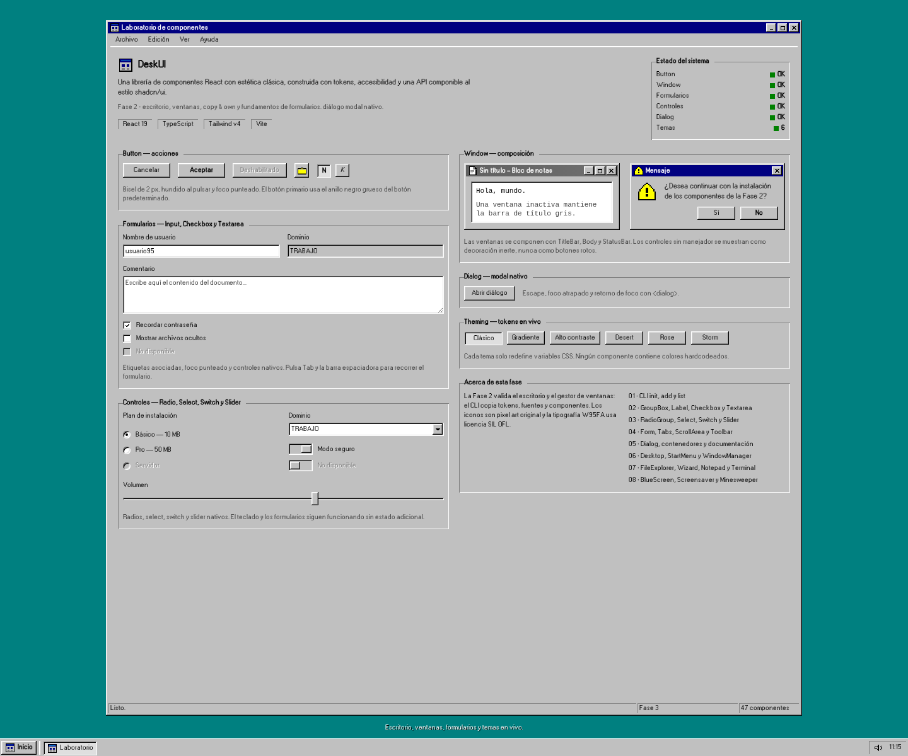

# Componentes de DeskUI



Los componentes comparten:

- `ref` hacia el elemento raíz.
- `className` fusionado con `cn` (Tailwind Merge).
- `data-slot` para inspección.
- Tokens para todo el estilo.
- Foco visible con `focus-visible`, no con el foco del ratón.

## Button

```tsx
import { Button } from "@deskui/ui";

<Button>Cancelar</Button>
<Button variant="primary">Aceptar</Button>
<Button variant="icon" size="icon" aria-label="Abrir carpeta">
  <FolderIcon />
</Button>
```

| Prop | Tipo | Default | Descripción |
| --- | --- | --- | --- |
| `variant` | `"default" \| "primary" \| "icon"` | `"default"` | Bisel estándar, anillo grueso de botón predeterminado o botón cuadrado |
| `size` | `"sm" \| "md" \| "lg" \| "icon"` | `"md"` | Alturas 21/23/27 px en escritorio; 24 px en móvil |
| `asChild` | `boolean` | `false` | Renderiza el hijo (por ejemplo un `<a>`) con el estilo del botón |
| `aria-pressed` | `boolean` | — | Activa el estado hundido de toggle |
| `disabled` | `boolean` | `false` | Texto grabado con relieve y sin interacción |

Notas:

- `type` es `"button"` por defecto para evitar envíos accidentales de formularios.
- En un botón solo icono, el nombre accesible es obligatorio (`aria-label`).
- El estado `active` se resuelve con CSS nativo; no hay estado React adicional.
- `asChild` usa `@radix-ui/react-slot`.

## Window

```tsx
import { Window } from "@deskui/ui";

<Window active aria-label="Documento">
  <Window.TitleBar
    title="Sin título - Bloc de notas"
    icon={<NoteIcon />}
    onMinimize={minimize}
    onMaximize={toggleMaximize}
    onClose={close}
  />
  <Window.Body>
    <p>Hola, mundo.</p>
  </Window.Body>
  <Window.StatusBar>
    <Window.StatusField>Listo</Window.StatusField>
  </Window.StatusBar>
</Window>
```

### Window

| Prop | Tipo | Default | Descripción |
| --- | --- | --- | --- |
| `active` | `boolean` | `true` | Barra de título azul o gris |
| `role` | nativo | — | Usa `dialog` para diálogos, `region` implícito al nombrar una `section` |
| `aria-label` / `aria-labelledby` | nativo | — | Nombre accesible de la ventana |

El elemento raíz es `<section>`. Añade `role="dialog"` y `aria-modal` cuando
corresponda.

### Window.TitleBar

| Prop | Tipo | Default | Descripción |
| --- | --- | --- | --- |
| `title` | `ReactNode` | — | Texto del título; `children` tiene prioridad |
| `icon` | `ReactNode` | — | Icono de 16×16 |
| `active` | `boolean` | heredado | Sobrescribe el estado de la ventana |
| `showControls` | `boolean` | `true` | Muestra u oculta el grupo de controles |
| `showMinimize` / `showMaximize` / `showClose` | `boolean` | `true` | Control individual |
| `maximized` | `boolean` | `false` | Cambia el glifo de maximizar por restaurar |
| `onMinimize` / `onMaximize` / `onClose` | `() => void` | — | Si falta el manejador, el control se dibuja inerte |

Los controles sin manejador son `span` decorativos, no botones sin acción. Esto
evita prometer interacción que no existe.

### Window.Body

| Prop | Tipo | Default | Descripción |
| --- | --- | --- | --- |
| `padded` | `boolean` | `true` | Aplica el margen clásico de 8 px |

### Window.StatusBar / Window.StatusField

La barra usa `display:flex` y `gap:1px`. Cada campo tiene el bisel de estado y
`flex:1`; puedes limitar su ancho con `className`.

Accesibilidad:

- El título no es un encabezado por defecto; si la ventana es una región
  principal, añade un `<h2>` o usa `aria-labelledby`.
- Los controles tienen `aria-label` en español por defecto; usa
  `DeskUILocaleProvider` para cambiarlos a inglés.
- La ventana inactiva solo cambia el color; no cambia el orden de tabulación.

## GroupBox

```tsx
<GroupBox legend="Opciones de instalación">
  <Checkbox defaultChecked>Crear acceso directo</Checkbox>
  <Checkbox>Iniciar sesión</Checkbox>
</GroupBox>
```

| Prop | Tipo | Default | Descripción |
| --- | --- | --- | --- |
| `legend` | `ReactNode` | — | Título y nombre accesible del fieldset |
| `className` | `string` | — | Clases adicionales para el fieldset |

La leyenda se apoya sobre la línea superior y su fondo enmascara el borde,
creando la muesca clásica. Mantiene `fieldset`/`legend` para que el grupo tenga
nombre accesible y semántica de formulario.

## Input

```tsx
import { Input } from "@deskui/ui";

<label htmlFor="usuario">Nombre de usuario</label>
<Input id="usuario" placeholder="usuario95" />
```

| Prop | Tipo | Default | Descripción |
| --- | --- | --- | --- |
| `type` | nativo | `"text"` | Cualquier tipo de input |
| `value` / `defaultValue` / `onChange` | nativo | — | Controlado o no controlado |
| `readOnly` | `boolean` | `false` | Fondo gris, texto normal |
| `disabled` | `boolean` | `false` | Fondo gris y texto grabado |
| `aria-invalid` | nativo | — | Reservado para la variante de error de Fase 1 |

Notas:

- Altura 21 px en escritorio y 24 px en móvil.
- El campo usa `bevel-field`: borde oscuro arriba/izquierda y claro abajo/derecha.
- El foco es un rectángulo punteado interior, no un anillo.
- Asocia siempre una etiqueta con `htmlFor`/`id` o `aria-label`.

## Label

```tsx
<Label htmlFor="usuario">Nombre de usuario</Label>
<Input id="usuario" />
```

| Prop | Tipo | Default | Descripción |
| --- | --- | --- | --- |
| `htmlFor` | `string` | — | Id del control asociado |
| `className` | `string` | — | Clases adicionales |

No envuelve al control por defecto; usa `htmlFor`/`id`. Puede envolver un
`Checkbox` cuando el texto forma parte del control.

## Checkbox

```tsx
<Checkbox defaultChecked>Recordar contraseña</Checkbox>
<Checkbox disabled>No disponible</Checkbox>
```

| Prop | Tipo | Default | Descripción |
| --- | --- | --- | --- |
| `checked` / `defaultChecked` | `boolean` | — | Estado controlado o no controlado |
| `onChange` | `ChangeEventHandler` | — | Manejador nativo |
| `disabled` | `boolean` | `false` | Caja gris y texto grabado |
| `children` | `ReactNode` | — | Texto visible y nombre accesible |

El `<input type="checkbox">` nativo está superpuesto y conserva teclado,
formularios, `indeterminate` y lectores de pantalla. La caja de 13×13 px y el
check pixelado son solo la representación visual. El área táctil mínima es de
24 px en móvil.

## Textarea

```tsx
<Label htmlFor="notas">Notas</Label>
<Textarea id="notas" rows={4} placeholder="Escribe aquí..." />
```

| Prop | Tipo | Default | Descripción |
| --- | --- | --- | --- |
| `rows` | `number` | — | Número inicial de filas |
| `readOnly` | `boolean` | `false` | Fondo gris, sin edición |
| `disabled` | `boolean` | `false` | Fondo gris y texto grabado |

Altura mínima de 60 px y redimensionado vertical. Comparte bisel, foco y
selección con `Input`.

## RadioGroup

```tsx
<RadioGroup defaultValue="basico" aria-label="Plan">
  <RadioGroupItem value="basico">Básico</RadioGroupItem>
  <RadioGroupItem value="pro">Pro</RadioGroupItem>
</RadioGroup>
```

| Prop | Tipo | Default | Descripción |
| --- | --- | --- | --- |
| `value` / `defaultValue` | `string` | — | Valor controlado o no controlado |
| `onValueChange` | `(value: string) => void` | — | Cambio de selección |
| `name` | `string` | `useId()` | Nombre nativo de los radios |
| `disabled` | `boolean` | `false` | Deshabilita el grupo |

Usa radios nativos: flechas, foco y formularios funcionan sin lógica extra.
`RadioGroupItem` recibe `value` y su etiqueta como `children`.

## Select

```tsx
<Select defaultValue="trabajo" aria-label="Dominio">
  <option value="trabajo">TRABAJO</option>
  <option value="casa">CASA</option>
</Select>
```

Select nativo con campo hundido y un botón de flecha visual a la derecha. Al
ser un `<select>`, conserva teclado, lectores de pantalla y envío de
formularios. No está pensado para `multiple`.

## Switch

```tsx
<Switch defaultChecked>Modo seguro</Switch>
```

| Prop | Tipo | Default | Descripción |
| --- | --- | --- | --- |
| `checked` / `defaultChecked` | `boolean` | `false` | Estado |
| `onCheckedChange` | `(checked: boolean) => void` | — | Cambio |
| `disabled` | `boolean` | `false` | Deshabilita |

Es un `<button role="switch">` con pista hundida y perilla elevada. Space y
Enter funcionan de forma nativa.

## Slider

```tsx
<Slider aria-label="Volumen" min={0} max={100} defaultValue={60} />
```

`input[type=range]` nativo. La pista de 4 px y el thumb rectangular de 11×21 px
se estilizan en `tokens.css` para WebKit y Firefox. Las flechas del teclado
funcionan de forma nativa.

## Form

```tsx
const form = useForm({
  resolver: zodResolver(schema),
  defaultValues: { usuario: "" },
});

<Form {...form}>
  <form onSubmit={form.handleSubmit(onSubmit)}>
    <FormField
      control={form.control}
      name="usuario"
      render={({ field }) => (
        <FormItem>
          <FormLabel>Usuario</FormLabel>
          <FormControl><Input {...field} /></FormControl>
          <FormMessage />
        </FormItem>
      )}
    />
  </form>
</Form>
```

| Pieza | Uso |
| --- | --- |
| `Form` | Provider de React Hook Form |
| `FormField` | Conecta `control`, `name` y `render` |
| `FormItem` | Agrupa label, control, descripción y error |
| `FormLabel` | Etiqueta asociada por id |
| `FormControl` | Propaga id, `aria-invalid` y `aria-describedby` con Slot |
| `FormDescription` | Texto de ayuda |
| `FormMessage` | Error de Zod con `role="alert"` |

## Tabs

```tsx
<Tabs defaultValue="general">
  <TabsList aria-label="Propiedades">
    <TabsTrigger value="general">General</TabsTrigger>
    <TabsTrigger value="avanzado">Avanzado</TabsTrigger>
  </TabsList>
  <TabsContent value="general">Contenido</TabsContent>
  <TabsContent value="avanzado">Opciones</TabsContent>
</Tabs>
```

Basado en Radix Tabs. Aporta roles, `aria-selected`, flechas, Home y End. La
pestaña activa elimina su borde inferior y se fusiona con el panel.

## ScrollArea

```tsx
<ScrollArea className="bevel-field h-32 bg-surface-sunken">
  <ul className="p-2">...</ul>
</ScrollArea>
```

| Prop | Tipo | Default | Descripción |
| --- | --- | --- | --- |
| `orientation` | `"vertical" \| "horizontal" \| "both"` | `"vertical"` | Ejes con scroll |
| `viewportClassName` | `string` | — | Clases del viewport |
| `children` | `ReactNode` | — | Contenido |

Scroll nativo con una barra clásica de 16 px dibujada por el componente:
flechas elevadas en los extremos, pista con trama de 50 % y thumb cuadrado.
El viewport conserva `tabIndex=0` para que el teclado pueda desplazar el
contenido; las flechas y la pista también responden al puntero y el thumb se
arrastra. Al usar controles propios, la geometría es idéntica en Chrome y
Firefox, que no permiten botones de flecha en las scrollbars nativas.

## Dialog

```tsx
const [open, setOpen] = useState(false);

<Button onClick={() => setOpen(true)}>Abrir mensaje</Button>

<Dialog
  open={open}
  onOpenChange={setOpen}
  title="Mensaje"
  footer={
    <>
      <Button size="sm" onClick={() => setOpen(false)}>Cancelar</Button>
      <Button size="sm" variant="primary" onClick={() => setOpen(false)}>
        Aceptar
      </Button>
    </>
  }
>
  <p>¿Desea continuar?</p>
</Dialog>
```

| Prop | Tipo | Default | Descripción |
| --- | --- | --- | --- |
| `open` | `boolean` | — | Controla la apertura |
| `onOpenChange` | `(open: boolean) => void` | — | Se llama al cerrar |
| `title` | `ReactNode` | — | Título y nombre accesible |
| `icon` | `ReactNode` | — | Icono de 16×16 |
| `footer` | `ReactNode` | — | Acciones alineadas a la derecha |
| `showClose` | `boolean` | `true` | Muestra el control de cierre |
| `dismissOnBackdrop` | `boolean` | `false` | Cierra al pulsar el fondo |

Usa `<dialog>` nativo: foco atrapado, Escape y retorno de foco sin dependencias
externas. El backdrop no cierra por defecto, como en la época.

## Alert

```tsx
<Alert variant="warning" icon={<WarningIcon />}>
  <AlertTitle>Advertencia</AlertTitle>
  <AlertDescription>El archivo ya existe.</AlertDescription>
</Alert>
```

Marco de ventana con una franja semántica (`info`, `success`, `warning`,
`danger`) y `role="alert"`. El texto permanece sobre la superficie.

## Badge

```tsx
<Badge>Nuevo</Badge>
<Badge variant="success">Activo</Badge>
<Badge variant="danger">Error</Badge>
```

Etiqueta biselada de 17 px. El texto usa el color de tinta y el estado se
representa con un punto semántico.

## Toast

```tsx
const { toast } = useToast();

toast({ title: "Guardado", description: "Cambios aplicados." });
```

`ToastProvider` envuelve la aplicación y renderiza un viewport con
`aria-live="polite"`. Cada toast es `role="status"`, se puede cerrar y admite
`duration` (0 lo deja abierto).

## ProgressBar

```tsx
<ProgressBar aria-label="Copia" value={35} />
```

Barra hundida con bloques azules segmentados. Expone `role="progressbar"` y
`aria-valuenow/min/max`. `segmented={false}` muestra una barra sólida.

## Tooltip

```tsx
<Tooltip>
  <TooltipTrigger asChild><Button>Guardar</Button></TooltipTrigger>
  <TooltipContent>Guardar cambios (Ctrl+S)</TooltipContent>
</Tooltip>
```

Radix Tooltip con fondo amarillo clásico, apertura por hover/foco y cierre con
Escape.

## MenuBar

```tsx
<MenuBar aria-label="Aplicación">
  <MenuBarMenu label="Archivo">
    <MenuBarItem onSelect={nuevo}>Nuevo</MenuBarItem>
    <MenuBarSeparator />
    <MenuBarItem onSelect={salir}>Salir</MenuBarItem>
  </MenuBarMenu>
</MenuBar>
```

Barra de menús sobre Radix Menubar. Incluye `MenuBarShortcut` y etiquetas. La
navegación por teclado y los submenús son nativos de Radix.

## DropdownMenu

```tsx
<DropdownMenu>
  <DropdownMenuTrigger asChild><Button>Opciones</Button></DropdownMenuTrigger>
  <DropdownMenuContent>
    <DropdownMenuItem>Renombrar</DropdownMenuItem>
    <DropdownMenuSeparator />
    <DropdownMenuItem>Eliminar</DropdownMenuItem>
  </DropdownMenuContent>
</DropdownMenu>
```

Menú desplegable clásico con items, etiquetas y separadores.

## ContextMenu

```tsx
<ContextMenu>
  <ContextMenuTrigger asChild><div>Haz clic derecho</div></ContextMenuTrigger>
  <ContextMenuContent>
    <ContextMenuItem>Copiar</ContextMenuItem>
  </ContextMenuContent>
</ContextMenu>
```

Menú contextual sobre Radix; se abre con clic derecho y comparte el estilo de
los otros menús.

## Breadcrumb

```tsx
<Breadcrumb>
  <BreadcrumbList>
    <BreadcrumbItem><BreadcrumbLink href="/">Inicio</BreadcrumbLink></BreadcrumbItem>
    <BreadcrumbSeparator />
    <BreadcrumbItem><BreadcrumbPage>Button</BreadcrumbPage></BreadcrumbItem>
  </BreadcrumbList>
</Breadcrumb>
```

Migas de pan con separadores decorativos y `aria-current="page"` en el nivel
actual.

## TreeView

```tsx
<TreeView aria-label="Archivos" defaultExpanded={["c"]} defaultValue="docs">
  <TreeItem value="c" label="C:" icon={<FolderIcon />}>
    <TreeItem value="docs" label="Documentos" icon={<FolderIcon />} />
  </TreeItem>
</TreeView>
```

Árbol de explorador con `role="tree"`, selección, expansión y navegación por
flechas. `aria-level`, `aria-selected` y `aria-expanded` se generan solos.

## Pagination

```tsx
<Pagination page={page} pageCount={12} onPageChange={setPage} />
```

Botones Anterior/Siguiente, páginas y elipsis. La página actual queda hundida
y usa `aria-current="page"`.

## Table

```tsx
<Table aria-label="Archivos">
  <TableHeader>
    <TableRow>
      <TableHead>Nombre</TableHead>
      <TableHead>Tamaño</TableHead>
    </TableRow>
  </TableHeader>
  <TableBody>
    <TableRow selected>
      <TableCell>carta.txt</TableCell>
      <TableCell>2 KB</TableCell>
    </TableRow>
  </TableBody>
</Table>
```

Tabla con contenedor biselado, cabecera elevada y sticky, cuerpo blanco y filas
seleccionables en azul. Composición: `TableHeader`, `TableBody`, `TableFooter`,
`TableRow`, `TableHead`, `TableCell` y `TableCaption`.

## ListBox

```tsx
<ListBox aria-label="Archivos" size={5} defaultValue="carta">
  <option value="carta">carta.txt</option>
  <option value="notas">notas.txt</option>
</ListBox>
```

Select nativo con varias filas visibles, bisel hundido y selección simple o
múltiple. Conserva teclado, Ctrl/Shift y semántica de formulario.

## StatusBar

```tsx
<StatusBar aria-label="Estado">
  <StatusBarField>Listo</StatusBarField>
  <StatusBarField>3 objetos</StatusBarField>
</StatusBar>
```

Barra de estado con campos segmentados y `bevel-status`. `Window.StatusBar`
reutiliza estos primitives.

## Icon

```tsx
<Icon name="folder" label="Carpeta" />
<Icon name="warning" size={32} label="Advertencia" />
<Icon name="info" />
```

Set original de iconos pixel-art: `window`, `folder`, `palette`, `info`,
`warning`, `note` y `speaker`. Tamaños 16/32; sin `label` son decorativos.

## TitleBar

```tsx
<TitleBar
  title="Sin título - Bloc de notas"
  icon={<NoteIcon />}
  onClose={cerrar}
/>
```

Barra de título reutilizable fuera de `Window`, con icono, controles de
minimizar/maximizar/restaurar/cerrar y estados activo/inactivo. Los controles
sin handler son inertes.

## Taskbar

```tsx
<Taskbar aria-label="Barra de tareas">
  <TaskbarStart icon={<BrandMark />}>Inicio</TaskbarStart>
  <TaskbarDivider />
  <TaskbarItem active icon={<NoteIcon />}>Documento</TaskbarItem>
  <TaskbarTray>12:00</TaskbarTray>
</Taskbar>
```

Barra base con `TaskbarStart`, `TaskbarItem`, `TaskbarDivider` y `TaskbarTray`.
El menú Inicio y el Window Manager se construyen encima; la barra no impone
estado global.

## Panel

```tsx
<Panel>
  <PanelHeader>
    <PanelTitle>Estado del sistema</PanelTitle>
  </PanelHeader>
  <PanelBody>Todos los controladores están cargados.</PanelBody>
  <PanelFooter>
    <Button size="sm">Detalles</Button>
  </PanelFooter>
</Panel>
```

| Prop | Tipo | Default | Descripción |
| --- | --- | --- | --- |
| `variant` | `"raised" \| "sunken" \| "window" \| "flat"` | `"raised"` | Receta de bisel |
| `padding` | `"none" \| "sm" \| "md" \| "lg"` | `"md"` | Relleno interior |

`Panel` es presentacional; elige el elemento semántico exterior o añade
`role`/`aria-label`. `PanelHeader`, `PanelTitle`, `PanelBody` y `PanelFooter`
son opcionales y solo aportan estructura visual.

## Card

```tsx
<Card>
  <CardHeader>
    <CardTitle>Disquete 3,5</CardTitle>
    <CardDescription>Almacenamiento extraíble</CardDescription>
  </CardHeader>
  <CardContent>1,44 MB · Alta densidad</CardContent>
  <CardFooter>
    <Badge variant="success">En stock</Badge>
    <Button size="sm" variant="primary">Añadir</Button>
  </CardFooter>
</Card>
```

`Card` renderiza un `article` con bisel elevado. El título es un `h3` por
defecto: mantén la jerarquía de encabezados de la página. Si la tarjeta es
interactiva, envuelve el título en un enlace o botón en lugar de añadir un
`onClick` al artículo.

## Separator

```tsx
<Separator />
<Separator orientation="vertical" />
```

| Prop | Tipo | Default | Descripción |
| --- | --- | --- | --- |
| `orientation` | `"horizontal" \| "vertical"` | `"horizontal"` | Dirección |
| `decorative` | `boolean` | `false` | Oculta el separador a lectores |

Expone `role="separator"` y `aria-orientation`. Marca `decorative` cuando la
separación sea solo visual. En vertical necesita una altura definida por el
contenedor (`self-stretch`).

## Toolbar

```tsx
<Toolbar aria-label="Formato de texto">
  <ToolbarGroup aria-label="Estilo">
    <ToolbarButton pressed={bold} onClick={toggleBold}>N</ToolbarButton>
    <ToolbarButton pressed={italic} onClick={toggleItalic}>K</ToolbarButton>
  </ToolbarGroup>
  <ToolbarSeparator />
  <ToolbarButton variant="icon" size="icon" aria-label="Abrir carpeta">
    <FolderIcon />
  </ToolbarButton>
</Toolbar>
```

`Toolbar` usa `role="toolbar"` y navegación con flechas, Home y End además de
Tab. `ToolbarButton` añade `aria-pressed` mediante `pressed`. Añade siempre un
`aria-label` a la barra y a los botones que solo muestran un icono.

## Desktop

```tsx
<Desktop aria-label="Escritorio">
  <DesktopIcons>
    <DesktopIcon
      label="Mi PC"
      icon={<Icon name="window" size={32} />}
      selected={selected === "mi-pc"}
      onSelect={() => setSelected("mi-pc")}
      onOpen={() => abrir("mi-pc")}
    />
    <DesktopIcon
      label="Notas"
      icon={<Icon name="note" size={32} />}
      draggable
      defaultPosition={{ x: 180, y: 16 }}
      onOpen={() => abrir("notas")}
    />
  </DesktopIcons>
</Desktop>
```

| Prop | Tipo | Default | Descripción |
| --- | --- | --- | --- |
| `label` / `icon` | `string` / `ReactNode` | — | Nombre accesible e icono |
| `selected` | `boolean` | `false` | Marca el icono con `aria-current` |
| `onSelect` / `onOpen` | `() => void` | — | Selección y apertura (doble clic o Enter) |
| `draggable` / `defaultPosition` | `boolean` / `{ x, y }` | `false` / — | Activa el arrastre absoluto |
| `onPositionChange` | `(position) => void` | — | Posición tras arrastre o Ctrl+flechas |

`Desktop` expone `role="region"`; pásale un `aria-label` descriptivo. El
arrastre se limita a los bordes del escritorio y no abre el icono si hubo
movimiento. Con `draggable`, `Ctrl+flechas` mueve el icono 8 px.

## StartMenu

```tsx
<StartMenu>
  <StartMenuTrigger asChild>
    <TaskbarStart icon={<BrandMark />}>Inicio</TaskbarStart>
  </StartMenuTrigger>
  <StartMenuContent>
    <div className="flex">
      <StartMenuSidebar>DeskUI</StartMenuSidebar>
      <div className="min-w-[210px] py-1">
        <StartMenuSub>
          <StartMenuSubTrigger>Accesorios</StartMenuSubTrigger>
          <StartMenuSubContent>
            <StartMenuItem onSelect={abrirBloc}>Bloc de notas</StartMenuItem>
          </StartMenuSubContent>
        </StartMenuSub>
        <StartMenuSeparator />
        <StartMenuItem onSelect={apagar}>Apagar el sistema...</StartMenuItem>
      </div>
    </div>
  </StartMenuContent>
</StartMenu>
```

Basado en Radix DropdownMenu: aporta `role="menu"`, flechas, typeahead, Escape,
cierre al hacer clic fuera y submenús en cascada. `StartMenuSidebar` es
decorativa y queda oculta a lectores de pantalla. Usa `asChild` en el trigger
para reutilizar el botón Inicio de `Taskbar`.

## WindowManager

```tsx
const manager = useRef<WindowManagerHandle>(null);

<WindowManager
  ref={manager}
  aria-label="Escritorio"
  windows={[
    {
      id: "notas",
      title: "Bloc de notas",
      icon: <NoteIcon />,
      content: <Editor />,
      defaultPosition: { x: 16, y: 16 },
      defaultSize: { width: 280, height: 180 },
    },
  ]}
  onStateChange={setSnapshot}
/>
```

| Prop | Tipo | Default | Descripción |
| --- | --- | --- | --- |
| `windows` | `WindowManagerWindow[]` | — | Ventanas, contenido y geometría inicial |
| `onStateChange` | `(snapshot) => void` | — | Estado para taskbar |
| `onWindowClose` | `(id) => void` | — | Notificación de cierre |
| `ref` | `WindowManagerHandle` | — | `focus`, `minimize`, `restore`, `close`, `open`, `toggleMaximize` |

Arrastra desde la barra de título y redimensiona desde los ocho bordes. Doble
clic en la barra maximiza/restaura. Con la barra enfocada, las flechas mueven
8 px y `Shift+flechas` redimensionan. Las ventanas minimizadas usan `hidden`,
salen del layout y del árbol accesible. El z-index se deriva del orden de foco.

## FileExplorer

```tsx
const root = {
  id: "root",
  name: "C:",
  kind: "folder",
  children: [
    { id: "docs", name: "DOCUMENTOS", kind: "folder", children: [...] },
    { id: "readme", name: "LEEME.TXT", kind: "file", size: "2 KB" },
  ],
};

<FileExplorer root={root} className="h-80" />
```

| Prop | Tipo | Default | Descripción |
| --- | --- | --- | --- |
| `root` | `FileExplorerItem` | — | Árbol de carpetas y archivos |
| `view` / `defaultView` | `"icons" \| "list" \| "details"` | `"icons"` | Vista actual |
| `onSelect` / `onOpen` | `(item) => void` | — | Selección y apertura |
| `onFolderChange` | `(folder) => void` | — | Navegación entre carpetas |

El árbol usa `TreeView`; doble clic o Enter abre carpetas y los archivos
disparan `onOpen`. El historial Atrás/Adelante y el botón Arriba son internos.

## Wizard

```tsx
<Wizard
  steps={[
    { id: "welcome", title: "Bienvenida", content: <p>Empieza aquí.</p> },
    { id: "name", title: "Nombre", content: <Input ... /> },
    { id: "finish", title: "Finalizar", content: <p>Listo.</p> },
  ]}
  canGoNext={(step) => step.id !== "name" || name.length > 0}
  onComplete={() => guardar()}
  onCancel={() => cerrar()}
/>
```

| Prop | Tipo | Default | Descripción |
| --- | --- | --- | --- |
| `steps` | `WizardStep[]` | — | Pasos con contenido |
| `step` / `defaultStep` | `number` | `0` | Paso controlado o inicial |
| `canGoNext` | `(step, index) => boolean` | `true` | Valida el paso actual |
| `onComplete` / `onCancel` | `() => void` | — | Acciones finales |

El paso activo usa `aria-current="step"` y el contenido se anuncia con
`aria-live`. Atrás se deshabilita en el primer paso; Finalizar sustituye a
Siguiente en el último.

## PropertiesDialog

```tsx
<PropertiesDialog
  open={open}
  onOpenChange={setOpen}
  title="Propiedades de Mi PC"
  tabs={[
    { id: "general", label: "General", content: <General /> },
    { id: "system", label: "Sistema", content: <Sistema /> },
  ]}
  onApply={() => aplicar()}
/>
```

Compone `Dialog` (modal nativo) y `Tabs`. Aplicar se deshabilita si no hay
handler; Aceptar aplica, confirma y cierra; Cancelar cierra sin aplicar.

## Notepad

```tsx
<Notepad
  fileName="carta.txt"
  defaultValue="Hola, mundo."
  onSave={(value) => guardar(value)}
  onNew={() => nuevo()}
/>
```

| Prop | Tipo | Default | Descripción |
| --- | --- | --- | --- |
| `value` / `defaultValue` | `string` | `""` | Contenido |
| `fileName` | `string` | `"Sin título"` | Nombre en la barra de estado |
| `onSave` / `onNew` / `onOpen` | `(value?) => void` | — | Acciones y atajos |
| `showMenuBar` | `boolean` | `true` | Menú Archivo/Edición/Formato |

Es contenido de ventana: no incluye barra de título. `Ctrl+S`, `Ctrl+N` y
`Ctrl+O` ejecutan Guardar, Nuevo y Abrir.

## Terminal

```tsx
<Terminal
  prompt="C:\>"
  commands={{ saludo: () => "Hola desde la terminal" }}
  onCommand={(command) => registrar(command)}
/>
```

Incluye `help`, `ver`, `cls`, `dir` y `echo`; los comandos personalizados
tienen prioridad. La salida usa `role="log"` y `aria-live="polite"`. Los colores
salen de tokens de terminal con overrides para alto contraste.

## BlueScreen

```tsx
<BlueScreen
  title="DeskUI"
  message="Se ha producido un error fatal..."
  code="ERROR 0E : 016F : BFF9B3D4"
  onRestart={() => reiniciar()}
/>
```

Expone `role="alert"`; sin `onRestart` no dibuja un botón inerte. Usa tokens de
acento e inverso para conservar el contraste en todos los temas.

## Screensaver

```tsx
<Screensaver
  title="DeskUI"
  hint="Mueve el ratón o pulsa una tecla"
  onDismiss={() => cerrar()}
/>
```

Campo de estrellas animado con `prefers-reduced-motion`. El bloque es focusable
y se cierra con clic, Escape, Enter o Space.

## Minesweeper

```tsx
<Minesweeper rows={9} cols={9} mines={10} seed={1} />
<Minesweeper layout={["..*", "...", "..."]} />
```

| Prop | Tipo | Default | Descripción |
| --- | --- | --- | --- |
| `rows` / `cols` / `mines` | `number` | `9 / 9 / 10` | Tablero generado |
| `layout` | `string[]` | — | Mapa determinista con `*` y `.` |
| `seed` | `number` | `1` | Semilla reproducible |
| `onWin` / `onLose` | `(...) => void` | — | Resultado de la partida |

Clic descubre, clic derecho o `F` marca bandera. Cada celda expone fila, columna
y estado en su nombre accesible. El temporizador arranca con la primera celda.

## i18n

`DeskUILocaleProvider` traduce los textos internos de los componentes. Sin
proveedor se usa español; `locale="en"` activa inglés. Las props explícitas
siguen teniendo prioridad.

```tsx
import { DeskUILocaleProvider } from "@deskui/ui";

<DeskUILocaleProvider locale="en">
  <App />
</DeskUILocaleProvider>
```

Puedes sobrescribir etiquetas concretas por sección:

```tsx
<DeskUILocaleProvider
  locale="en"
  messages={{ pagination: { next: "Forward" } }}
>
```

Con el CLI, importa el proveedor desde `@/lib/i18n`; el registry copia ese
archivo como dependencia. Componentes con textos internos: `Pagination`, `Wizard`, `PropertiesDialog`,
`Notepad`, `FileExplorer`, `Minesweeper`, `Terminal`, `BlueScreen`,
`Screensaver`, `TitleBar`, `Toast`, `ScrollArea` y `Desktop`. El helper vive en
`lib/i18n.tsx` y se copia con el componente.

## Registry

Cada componente se publica como un item independiente:

```text
utils → —
i18n → —
alert → utils
badge → utils
blue-screen → utils, button, i18n
breadcrumb → utils
button → utils
card → utils
checkbox → utils
context-menu → utils
desktop → utils, i18n
dialog → utils, window
dropdown-menu → utils
file-explorer → utils, icon, input, table, toolbar, tree-view, status-bar, i18n
form → utils, label
group-box → utils
icon → utils
input → utils
label → utils
list-box → utils
menu-bar → utils
minesweeper → utils, i18n
notepad → utils, menu-bar, status-bar, textarea, i18n
pagination → utils, i18n
panel → utils
progress-bar → utils
properties-dialog → utils, button, dialog, tabs, i18n
radio-group → utils
screensaver → utils, i18n
scroll-area → utils, i18n
select → utils
separator → utils
slider → utils
start-menu → utils
status-bar → utils
switch → utils
table → utils
tabs → utils
taskbar → utils, button
terminal → utils, i18n
textarea → utils
title-bar → utils, i18n
toast → utils, i18n
toolbar → utils, button, separator
tooltip → utils
tree-view → utils
window → utils, title-bar, status-bar
window-manager → utils, window
wizard → utils, button, i18n
```

El registry tiene 49 items (utils + i18n + 47 componentes). Los targets son
`components/ui/*.tsx`, `lib/utils.ts` y `lib/i18n.tsx`. El generador reescribe los imports
relativos a `@/lib/utils` y produce JSON en `packages/ui/dist/registry`. El CLI
incluye una copia del registry para funcionar sin conexión.

